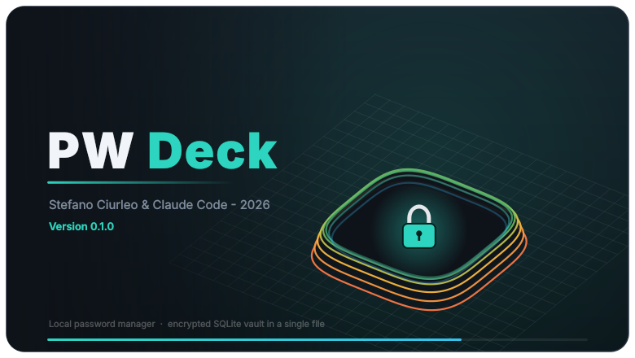
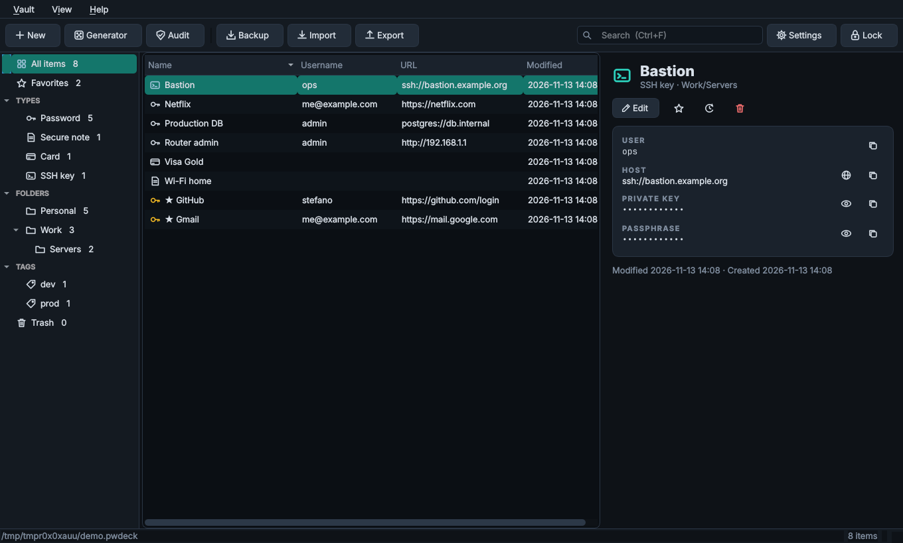

# PW Deck

Local **password manager** with the same dark look as [CNC Deck](https://github.com/stefanolmo/cncgrbl): no server, no cloud, no account.
Everything lives in **one encrypted file** (`.pwdeck`) that contains an **SQLite** database. Copy the file to back it up or to move
it to another computer.
Python 3.11+ · Qt6 (PySide6) · `cryptography` ≥ 46 (Argon2id). Tested on Ubuntu 24.04.

<p align="center"></p>
<p align="center"></p>

## Installation (Ubuntu)

```bash
./install.sh          # venv in ~/.local/share/pwdeck, "pwdeck" launcher, menu entry
pwdeck                # or: pwdeck ~/passwords.pwdeck
```

Without installing: `pip install -r requirements.txt && python3 -m pwdeck`.

## What it stores (Passbolt-style resources)

| Type | Fields |
|---|---|
| **Password** | name, username, password, one or more URLs, **TOTP** (optional, live code), description |
| **TOTP** | stand-alone one-time code (Base32 secret or `otpauth://` URI, SHA1/256/512, 6–10 digits, any period) |
| **Secure note** | free text |
| **Card** | holder, number, expiry, CVV, PIN, notes |
| **SSH key** | user, host, private key, public key, passphrase, notes |
| **Custom** | description + any number of custom fields |

Every item can also have: **custom fields** (optionally hidden), **folders** (nested), **tags**, **favorite**, an **expiry date**,
**attachments** (files up to 16 MiB each, sealed individually like every secret), a 25-entry **history** of previous secrets, and goes to the **trash** before being deleted for good.

## Features

| | |
|---|---|
| Vault | single file, AES-256-GCM, **Argon2id** key derivation (older vaults: scrypt, upgradeable in Settings → Key derivation), atomic writes (temp file + fsync + rename), a write after every change |
| Unlock | master password **+ optional keyfile** (second factor) **+ recovery key** (printed once at creation) |
| Generator | CSPRNG, length 8–128, character classes, no look-alikes, guaranteed one char per class, strength meter |
| Clipboard | auto-clear after N seconds (only if it still holds *your* value), asks clipboard managers (KDE/Klipper) not to record it |
| Auto-lock | after N idle minutes, optionally on minimize, and **when the screen locks or the PC suspends** (systemd-logind with a delay inhibitor, KDE/GNOME lock screen, over D-Bus; on by default); the key is dropped from the app on lock |
| Process hardening | no core dumps (`RLIMIT_CORE=0`); `prctl(PR_SET_DUMPABLE, 0)` blocks ptrace and `/proc/PID/mem` for other processes of the same user, applied only where the kernel's Yama `ptrace_scope` is 0 (it is already 1 on Ubuntu/Fedora, which gives the same protection). `PWDECK_HARDEN=auto\|always\|never` |
| Search | all words must match across name, username, URL, tags, folder (descriptions and notes are sealed and therefore **not** searched) |
| Audit | weak, reused, old, expired passwords; optional online breach check (Have I Been Pwned *k-anonymity*: only 5 hash chars leave the PC, on explicit click) |
| Backup | verified copy, rotating **automatic backups** (keep last N), and an **Emergency kit** zip (vault + standalone recovery script + instructions) |
| Import | generic CSV with auto-detected columns (Passbolt, KeePass, Bitwarden, LastPass, Chrome, 1Password… — see below), Bitwarden JSON, PW Deck JSON; duplicates skipped |
| Export | CSV / JSON **in clear text** (mode 600, with a warning) — only for migrating away |
| Safety nets | detects when the file was changed by another program (sync client, other PC) before overwriting; instance lock; tamper detection |

Shortcuts: `Ctrl+N` new · `Ctrl+F` search · `Ctrl+U` copy username · `Ctrl+P` copy password · `Ctrl+T` copy TOTP · `Ctrl+E` edit · `Del` trash · `Ctrl+G` generator · `Ctrl+L` lock.

## Backup, and what to do if the PC dies

The vault file is **already encrypted**, so any copy is safe to store anywhere (USB stick, NAS, a cloud folder).

1. **Automatic**: Settings → *Automatic backups*: a verified copy is made when you unlock/lock (at most hourly), the newest N are kept.
   Default folder: `backups/` next to the vault. **Point it at another disk** — a backup on the same disk does not survive a disk failure.
2. **Manual**: *Backup → Save a verified copy…* (the copy is decrypted again and checked with SQLite `integrity_check`).
3. **Emergency kit**: *Backup → Emergency kit…* creates a zip with the vault, `pwdeck_recover.py` and instructions. Keep it with your documents.
   It contains **no** password and **no** recovery key.

Restoring on a new machine:

* with PW Deck: install it, *Open other…*, choose the file, enter the master password (+ keyfile). Nothing else to migrate.
* without PW Deck, only Python + `pip install cryptography`:
  ```bash
  python3 pwdeck_recover.py decrypt vault.pwdeck -o vault.sqlite          # a plain SQLite file, open it with any tool
  python3 pwdeck_recover.py csv     vault.pwdeck -o vault.csv --recovery  # using the recovery key
  ```

**You must keep, separately from the vault:** the master password (in your head / a sealed envelope), the **keyfile** if you use one
(losing it = losing the vault), and the **recovery key**. Without them nobody can open the file — there is no reset.

## File format and security notes

```
"PWDECK\0\1" | u32 header length | JSON header | AES-256-GCM(DEK, nonce, sqlite bytes, aad=magic)
header: KDF (Argon2id or scrypt) params + salt, key slots {password, recovery} = AES-GCM-wrapped DEK, payload nonce
```

* The SQLite database is only ever in memory (`Connection.serialize()`) or encrypted; no plain temp file is written.
* **Format v2 — field sealing.** Inside the database every secret value (password, TOTP secret, description/notes, card number/CVV/PIN, SSH key,
  passphrase, custom-field values, history) is *also* encrypted on its own with AES-256-GCM, key = HKDF(data key), AAD = vault|item|column. Name, username, URLs,
  folders and tags stay readable so the list and the search work. The database that sits in RAM while the vault is unlocked therefore holds **no plaintext
  secrets**: a value is decrypted only when you reveal it, copy it, edit the item or run the audit/export. Old v1 vaults are migrated on first open
  (a copy of the old file is kept as `<vault>.pre-v2.bak`; delete it once you are happy, it still contains the old layout).
* A random 256-bit **data key** encrypts the content and is stored wrapped by a key derived from the password (Argon2id, 256 MiB, 3 passes, 4 lanes; "High": 512 MiB, 4 passes),
  and by the recovery key (HKDF). Changing the master password only rewrites the header.
* With a keyfile, the password is first combined as `HMAC-SHA256(SHA256(keyfile), password)`. The master password is NFKC-normalised.
* The whole file is authenticated: any modification is detected on open.
* **Attachments** live inside the database, so the whole vault stays in RAM and is rewritten at every save: fine for documents and keys, not for videos (hard limit 16 MiB per file; a vault with hundreds of MB will feel slow). CSV/JSON exports do not include them; the recovery tool extracts them (`pwdeck_recover.py attachments vault.pwdeck -o DIR`).
* **Upgrades leave a copy.** Opening a vault from an older version converts it and keeps the previous file as `<vault>.pre-v2.bak` / `.pre-v3.bak`; delete them when you are satisfied (they hold the old layout).
* **Not SQLCipher.** The file is not a SQLCipher database: it is an authenticated container around a normal SQLite image. The trade-offs: no extra native
  dependency, one authenticated blob, but the whole database is loaded in RAM and rewritten on each save (fine for thousands of entries, not for gigabytes).
* **What field sealing does and does not give you** (measured with `tests/test_memory.py`, which scans the memory of a real running process):
  right after unlock the secrets of *no* item are in RAM (before: all of them), selecting an item does not bring its masked secrets in, and after lock
  those never revealed are absent. It does **not** defeat an attacker who reads the whole process memory *and* understands the structure, because the
  field key is in the same process; it removes the easy wins (`strings`/grep on a dump, swap or hibernation pages, partial dumps, forensic carving).
  Exceptions: the TOTP secret of the *selected* item is decrypted to show the live code; whatever you revealed, copied or edited can stay in memory
  after you hide it or lock (Python and Qt do not zero freed memory; one hidden-field value was still found after hiding in the test); the Audit and Export
  decrypt everything while they run.
* **Hardening and the title bar**: `PR_SET_DUMPABLE=0` makes `/proc/PID` root-owned, which on GNOME/Wayland can leave the window's title bar without its minimize/maximize/close buttons
  (Qt asks the desktop portal for the button layout and the portal cannot inspect the process). That is why `auto` skips it when Yama already protects you; if you ever see a title bar without buttons run `PWDECK_HARDEN=never pwdeck`.
* **Hardening limits**: `PR_SET_DUMPABLE=0` does not stop root, a kernel exploit, or malware that injects code through your launcher/environment, and the sleep lock
  relies on the desktop/logind emitting the signals. Suspend is covered by a logind *delay inhibitor*: the app holds it, locks the vault when `PrepareForSleep` arrives and only then lets suspend proceed
  (logind waits at most `InhibitDelayMaxSec`, 5 s by default). Tested against a fake logind, not a real suspend.
* **Limits you should know about**: Python cannot reliably wipe secrets from memory, so while the vault is unlocked a process-memory dump
  can reveal them; a keylogger or malware running as your user defeats any local password manager; the clipboard is readable by other
  programs until it is cleared. The strength meter is a heuristic. This code has **not been independently audited**.
* If the vault is in a synced folder (Dropbox, Nextcloud…) do not edit it from two computers at the same time: the app will warn before overwriting
  a file that changed, but it does not merge.

## Import notes

CSV columns are matched by name (case-insensitive): `name/title`, `url/uri/login_uri`, `username/login/login_username`, `password/login_password`,
`notes/description`, `folder/group/grouping`, `totp/login_totp`, `type`, `favorite`, `tags`. The format has only been tested with synthetic files
modelled on KeePass/Bitwarden layouts, **not with real exports from every product**: check the result of your first import. KDBX (KeePass) and
encrypted exports are not supported — export unencrypted CSV/JSON, import, then delete the export.

## Development

```bash
pip install -e .[dev]
python -m pytest                                              # crypto, vault, TOTP (RFC 6238 vectors), generator, import/export, offscreen UI
QT_QPA_PLATFORM=offscreen python3 docs/make_screenshots.py    # regenerate the README images
```

The core (`crypto.py`, `vault.py`, `totp.py`, `generator.py`, `importers.py`) does not import Qt. `recover.py` is self-contained on purpose
and its compatibility with the main code is covered by a test.

## Ideas not implemented yet

Browser auto-fill extension (needs a local native-messaging bridge) · passphrase generator (needs a vetted word list) · KDBX import/export ·
multiple vaults at once · QR scan for TOTP · hardware keys (FIDO2 hmac-secret / YubiKey) as a second factor · merge of divergent vault copies.
